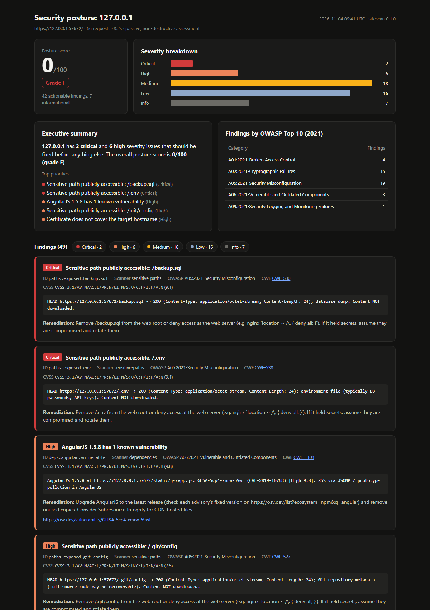

# sitescan

Passive, non-destructive web security posture assessment for sites **you are
authorized to test**. sitescan observes and analyzes responses. It does not
attack: no exploitation payloads, no brute force, no fuzzing, no DoS.



*Sample report generated against the deliberately misconfigured local test
app. See [`samples/`](samples/).*

## What it checks

| Scanner | Checks |
|---|---|
| `headers` | CSP (parsed: `unsafe-inline`, `unsafe-eval`, wildcard/scheme sources, `object-src`, `base-uri`), HSTS, X-Frame-Options / `frame-ancestors`, X-Content-Type-Options, Referrer-Policy, Permissions-Policy |
| `tls` | TLS 1.0–1.3 support, weak cipher families (NULL, anon, EXPORT, RC4, 3DES, static RSA), expiry window, self-signed, SAN mismatch, weak key, weak signature, chain validation |
| `cookies` | `Secure`, `HttpOnly`, `SameSite` on every `Set-Cookie` (values are redacted in reports) |
| `disclosure` | Server/X-Powered-By version banners, verbose error pages / stack traces, directory listing on common paths |
| `sensitive-paths` | **HEAD-only** probe of ~35 well-known paths (`/.git/config`, `/.env`, `/backup.sql`, `/phpinfo.php`, `/admin`, `/.DS_Store`, ...) with soft-404 detection. Contents are never downloaded. |
| `transport` | HTTP→HTTPS redirect (permanent, same host), active/passive mixed content, HSTS preload eligibility |
| `dns-email` | SPF, DKIM (common selectors), DMARC policy strength, CAA, zone transfer (AXFR refused = pass) |
| `dependencies` | Fingerprints jQuery, Bootstrap, AngularJS, Lodash, Moment, Vue, React, ... from URLs and banners, then queries [OSV.dev](https://osv.dev) for known CVEs |
| `wellknown` | robots.txt (flags revealing Disallow entries), sitemap.xml, security.txt per RFC 9116 |

Every finding carries an `id`, `title`, `severity` (Critical/High/Medium/Low/Info),
a CVSS 3.1 vector where meaningful, raw `evidence`, an OWASP Top 10 2021
category, a CWE id and a remediation paragraph.

## Install

Requires Python 3.11+.

```bash
python -m venv .venv
# Windows: .venv\Scripts\activate    macOS/Linux: source .venv/bin/activate
pip install -r requirements.txt
pip install -e .          # optional: puts a `sitescan` command on PATH
```

## Usage

```bash
sitescan https://staging.example.com --i-am-authorized
# -> Type the target hostname (staging.example.com) to confirm you are authorized:
```

Equivalent without installing: `python -m sitescan ...`.

```bash
# Reports
sitescan https://staging.example.com --i-am-authorized --html report.html --json report.json

# CI: non-interactive confirmation, JSON to stdout, fail the build on Medium+
sitescan https://staging.example.com --i-am-authorized --confirm-host staging.example.com \
    --json - --fail-on Medium

# Subset of checks, slower rate
sitescan https://staging.example.com --i-am-authorized --only headers,tls,cookies --rate 2

sitescan --list-scanners
```

| Option | Default | Meaning |
|---|---|---|
| `--i-am-authorized` | *required* | You assert you have permission to test the target |
| `--confirm-host HOST` | prompt | Non-interactive hostname confirmation (CI). Must equal the target host |
| `--rate N` | `5` | Max requests/second to the target, across all scanners (max 50) |
| `--timeout S` | `10` | Per-request timeout |
| `--only` / `--skip` | | Comma-separated scanner names |
| `--json PATH` | | JSON report (`-` = stdout) |
| `--html PATH` | | Self-contained HTML report (no external assets) |
| `--fail-on SEV` | `High` | Lowest severity that produces exit code 1 |
| `--scans-dir DIR` | `scans` | Where the per-scan audit log is written |
| `--ca-bundle PEM` | | Extra CA to trust when validating the chain (internal PKI) |
| `--http-url URL` | `http://<host>/` | Plain-HTTP URL for the redirect check |
| `--dns-domain D` | host minus `www.` | Domain for SPF/DMARC/DKIM/CAA/AXFR checks |
| `--no-osv` | | Don't query OSV.dev (fully offline dependency fingerprinting) |

### Exit codes

| Code | Meaning |
|---|---|
| 0 | Scan completed; nothing at or above `--fail-on` |
| 1 | Scan completed; High/Critical (or `--fail-on`) findings present |
| 2 | Usage error |
| 3 | Refused by the authorization gate or denylist |
| 4 | Fatal error |

## Safety controls

- **Authorization gate**: `--i-am-authorized` *and* a typed confirmation of the
  exact hostname. Without a TTY you must pass `--confirm-host`.
- **Denylist**: the tool refuses major third-party platforms (Google, Meta,
  Microsoft, AWS, GitHub, Cloudflare, payment providers, AI providers, ...) and
  the `.gov`/`.mil` TLDs. It checks the denylist before asking for confirmation.
  See `sitescan/core/gate.py`.
- **Safe methods only**: the HTTP layer refuses anything except
  GET/HEAD/OPTIONS. Sensitive-path probing is HEAD-only. Bodies are capped at 2 MiB.
- **Rate limit**: a global token bucket (default 5 req/s) covers every HTTP
  request, every redirect hop, every TLS handshake and every DNS query.
- **Identifying User-Agent**: `sitescan/0.1.0 (+passive security posture scanner; authorized testing only)`.
- **Audit log**: every scan writes `scans/<timestamp>-<host>.json` with the full
  result, the invocation, and the operator's username.
- **Third parties**: the only external service contacted is OSV.dev, and it
  receives only `{package, version}`. Scripts are fetched only from the target's
  own origin. CDN-hosted libraries are identified from their URL alone.

## Scoring

`score = max(0, 100 − Σ min(cap, count × weight))`

| Severity | Weight | Cap |
|---|---|---|
| Critical | 25 | 60 |
| High | 12 | 45 |
| Medium | 6 | 30 |
| Low | 2 | 12 |
| Info | 0 | 0 |

Grades: A ≥ 90, B ≥ 80, C ≥ 70, D ≥ 60, else F. Any Critical caps the grade at
D, and any High caps it at C. The caps stop 50 Low findings from outweighing one
Critical.

## Development

```bash
pip install -r requirements.txt
pytest                                  # 61 tests, ~15 s, no internet
python scripts/generate_sample.py       # regenerates samples/sample-report.{html,json}
```

The suite runs against a local Flask app (`tests/target_app/`) in three
profiles: `vulnerable`, `hardened` and `redirect`. These are served over plain
HTTP, over a deliberately bad TLS config (self-signed 1024-bit cert, TLS 1.0,
weak ciphers), and over a good TLS config signed by a throwaway local CA.
Every scanner has positive tests against the vulnerable profile and negative
tests against the hardened one. A session-wide guard patches
`socket.connect`/`sendto` so any attempt to reach a non-loopback address fails
the test. OSV responses are mocked, and DNS uses an injected fake resolver.

See [ARCHITECTURE.md](ARCHITECTURE.md) for how scanners are registered and how
to add one.

## Limitations

- TLS probing uses the local OpenSSL. Suites that build has removed (RC4,
  EXPORT, 3DES on most OpenSSL 3 builds) can't be negotiated, so they are
  reported as "not tested" in the scan notes, not as passing.
- DKIM can only be checked for common selector names.
- The mail domain is a heuristic (host minus `www.`). Use `--dns-domain` for
  the registrable domain.
- Library fingerprinting finds versions that are announced in URLs or banners.
  Bundled or minified code without banners won't be detected.
